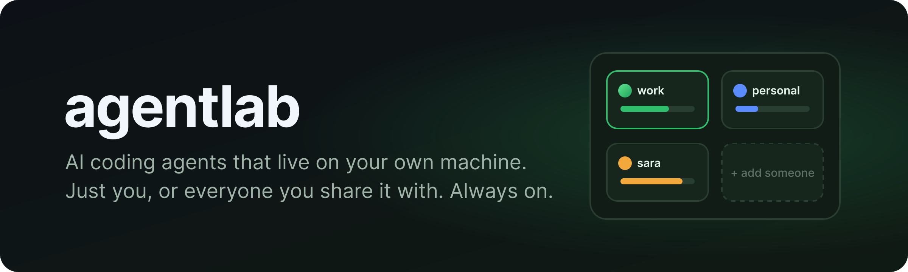

<p align="center">
  <b>Always-on AI coding agents on a machine you own: just for you, or shared with friends, family or a team.</b>
</p>

<p align="center">
  
  
  
</p>

---

## ✨ What you get

- 🧠 **Agents that keep going.** Chats live on the machine in [T3](https://github.com/pingdotgg/t3code). Close the
  laptop, check in from your phone.
- 🔑 **Your own AI accounts.** Sign in with your Claude or Codex subscription; connect GitHub, Linear, Notion…
- 🛠️ **A real workshop.** A browser you can watch, Docker, a terminal, a file manager and an Android emulator.
- 🗂️ **As many agents as you want.** Work, side projects, experiments: each with its own files and logins.
- 🌱 **A Slack companion.** A bot that works with your agent, and that your agent can change on request.
- 📊 **One dashboard.** Usage, devices and bots; heavy jobs queue up and old work gets cleaned for you.
- 🔄 **Keeps itself up to date.** T3, Claude and Codex update inside each agent; agentlab updates itself nightly,
  never mid-task.

## 🤝 Share it safely

- 🔐 Sign in through **Tailscale**, **Cloudflare** (only devices on your Cloudflare One client, over HTTPS with a real
  certificate and nothing to install on devices, or a sign-in page with Google, Microsoft or an email code) or a
  **Google login**.
- 🚪 Everyone gets their own sealed-off agents: no peeking at each other's files, chats or logins.
- 👀 Whoever runs the machine can see everything, so they can help. Make sure everyone knows who that is.

## 🚀 Get started

**Easiest:** give Claude Code or Codex access to the machine and say:

> *Set up agentlab from https://github.com/Radwan-Albahrani/agentlab using its skill.*

**Yourself:**

```sh
git clone https://github.com/Radwan-Albahrani/agentlab.git && agentlab/cli/agentctl setup
```

A few questions (how you'll reach it, your email, your agents), then it installs and starts everything. It only
stops when it needs you for something, like a token to paste or a link to open, and carries on from there.

New agent later? `agentctl agent add side-project you@example.com && agentctl apply`.
Ways to reach it from anywhere: [access guide](skills/agentlab/references/access.md).

## 📦 You'll need

- 🐧 Linux with Docker (or Windows with WSL)
- 💾 About 12 GB RAM and 30–60 GB disk per busy agent
- 🌐 Tailscale, Cloudflare, or a domain pointing at the machine

> 🧪 **Beta:** in daily use with Tailscale and Cloudflare. Please report what breaks.

## 📚 More

[How it works](docs/architecture.md) · [Operating it](skills/agentlab/references/operate.md) ·
[Contributing](CONTRIBUTING.md) · [Security](SECURITY.md) · [Code of Conduct](CODE_OF_CONDUCT.md) ·
[MIT License](LICENSE)
