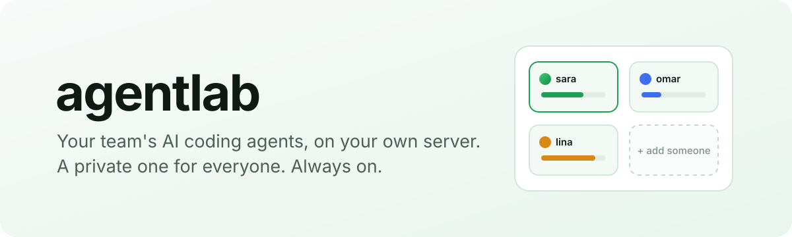

<p align="center">
  <picture>
    <source media="(prefers-color-scheme: dark)" srcset="docs/assets/banner-dark.svg">
    
  </picture>
</p>

<p align="center">
  <b>One server. A private AI coding agent for every person on your team.</b><br>
  Claude Code and Codex, with a real browser, Docker, a terminal and a phone emulator,<br>
  running around the clock on hardware you own.
</p>

<p align="center">
  <a href="#get-started">Get started</a> ·
  <a href="#what-everyone-gets">What everyone gets</a> ·
  <a href="#is-it-safe">Is it safe?</a> ·
  <a href="docs/architecture.md">How it works</a>
</p>

---

## Why

AI coding agents are at their best when they never stop: a long refactor that runs overnight, a test suite that takes
an hour, a pull request reviewed while you sleep. Laptops close, though, and handing your whole team one shared box
means everyone can see everyone's code, chats and logins.

**agentlab gives each person their own agent on a shared server**, behind your company's sign-in, so it keeps working
when they walk away and nobody can look over anyone else's shoulder.

## What everyone gets

<table>
<tr>
<td width="50%" valign="top">

### 🧠 Their own agent
They open `agents.yourcompany.com`, sign in with their work account and land in **their** agent. Not a shared one,
not someone else's. Own more than one? They pick.

</td>
<td width="50%" valign="top">

### 🔑 Their own AI accounts
The first visit walks them through signing in to **Claude** or **Codex** with their own subscription, and connecting
the tools they use (Linear, Notion, GitHub…). Then they're in.

</td>
</tr>
<tr>
<td valign="top">

### 💬 Chats that never stop
Conversations live on the server in [T3](https://github.com/pingdotgg/t3code). Start something on the desktop, close
the lid, check on it from your phone. Pair the T3 app with a QR code.

</td>
<td valign="top">

### 🛠️ A real workshop
Their agent drives a **Chrome** they can watch live, runs **Docker** for databases and tests, has a **terminal**, a
**file manager**, and an **Android emulator** for testing mobile apps.

</td>
</tr>
<tr>
<td valign="top">

### 🌱 A companion in Slack
Each agent can have a Slack bot that works with it: takes requests from the team, runs polls, reviews pull requests
with screenshots, posts updates. Ask your agent *"add a standup command to my bot"* and it changes the bot itself.

</td>
<td valign="top">

### 📊 Their own dashboard
Usage, storage, connected devices, their bot's tasks and settings, all in one place, showing only their own things.
Admins see the whole team.

</td>
</tr>
</table>

## Is it safe?

The short answer: everyone gets a locked room, and the admin holds the master key.

- 🔐 **Nobody gets in without your company's sign-in.** Use Cloudflare (Google, Microsoft or an email code), your
  Tailscale network, or a Google login on the server itself. Only the people you list, or your company's email domain,
  get through.
- 🚪 **Everyone stays in their own room.** Each agent is sealed off from the others: it can't see their files, reach
  their chats or talk to the shared services. Every single request is checked on the server, not just at the door.
- 💾 **Nothing is lost.** Work lives on the server, chats are backed up every night, and one person filling their disk
  doesn't stop anyone else.
- 👀 **The admin can see everything.** That's on purpose, so you can help when something breaks. Tell your team.

## Get started

### The easy way: let an AI agent install it

Give Claude Code or Codex SSH access to your server and say:

> *Install agentlab from https://github.com/Radwan-Albahrani/agentlab using its skill.*

It reads the [bundled skill](skills/agentlab/SKILL.md), asks you the few things only you know (your domain, who gets
an agent, how people sign in), does the rest, and stops for your yes before anything it can't undo.

### The hands-on way

```sh
git clone https://github.com/Radwan-Albahrani/agentlab.git && cd agentlab
cli/agentctl init            # one-time: puts agentctl on your PATH
agentctl config edit         # your domain, your people, how they sign in
agentctl doctor              # tells you what's missing and exactly how to fix it
agentctl install             # sets up the server
agentctl apply               # brings everyone's agent to life
```

That's the whole loop. Change the config, run `agentctl apply`, done. Adding a teammate is one line:

```sh
agentctl agent add sara sara@yourcompany.com && agentctl apply
```

The sign-in setup for each option (Cloudflare, Tailscale, Google login) is in the
[access guide](skills/agentlab/references/access.md).

### Just for you?

agentlab works great for one person too: run it on a home server or a Windows PC with WSL, reach it over Tailscale,
and pair the T3 app on your phone.

## What you need

- A Linux server with Docker. Ubuntu 24.04 is what it's built on.
- Roughly **12 GB of memory and 30–60 GB of disk per busy person**. A 128 GB / 512 GB machine is comfortable for 6–8
  people.
- One way in: a **Cloudflare** account, a **Tailscale** network, or a domain pointing at the server.

## Status

agentlab is **early**. Every part is tested and the whole system has run end to end, but a few pieces haven't been
proven on real hardware yet: the strongest isolation mode (Sysbox), the Android emulator, live Cloudflare / Tailscale
sign-in, and Coolify deploys. `agentctl doctor` checks each of them; if something breaks, please open an issue.

<details>
<summary><b>For the curious: what's inside</b></summary>

<br>

| Folder | What it is |
|---|---|
| [`cli/`](cli/README.md) | `agentctl`, the one command that sets up and runs everything |
| [`image/`](image/README.md) | what each person's agent runs: T3, Claude Code, Codex, Chrome, Docker, Android |
| [`gate/`](gate/README.md) | the sign-in check in front of every request |
| [`hub/`](hub/README.md) | the dashboard |
| [`companion/`](companion/README.md) | the Slack companion |
| [`host/`](host/README.md) | the background services that keep the server healthy: memory, disk, backups, firewall |
| [`skills/agentlab/`](skills/agentlab/SKILL.md) | the instructions an AI agent follows to install and run it |
| [`docs/architecture.md`](docs/architecture.md) | the full technical design |

Working on agentlab itself? `scripts/check.sh` runs every test with nothing but Docker installed.

</details>
