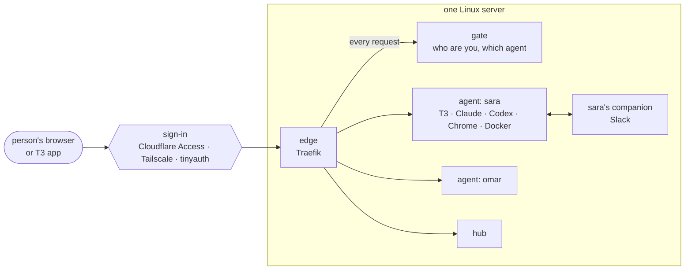

# agentlab

**Your own AI coding agents, on your own server, one private workspace per person.**

agentlab turns one Linux machine into a place where every person on a team gets their own always-on AI coding agent:
[T3](https://github.com/pingdotgg/t3code) chats driving Claude Code or Codex with *their own* accounts, a real browser,
Docker, a terminal, a file manager and an Android emulator. People sign in with the company's login and land straight
in their own agent; nobody can open anyone else's. Agents keep running when laptops close, and their Slack companions
keep working with them.

One config file describes the whole cluster. One command, `agentctl apply`, makes the server match it. And because
every command speaks JSON and never prompts, an AI agent with SSH access can install and run the whole thing for you,
following the [bundled skill](skills/agentlab/SKILL.md).

> **Status: early.** Every part is tested ([`scripts/check.sh`](scripts/check.sh)) and the full cluster has run end to
> end. Not yet proven on real hardware: Sysbox isolation, the Android emulator on KVM, live Cloudflare / Tailscale /
> tinyauth sign-in and Coolify deploys. `agentctl doctor` checks each one; please report what breaks.

---

## What each person gets

| | |
|---|---|
| **Their agent** at `https://agents.example.com` | Chosen by who they signed in as. Own several? They get a picker and can switch any time. |
| **Chats that live on the server** | T3 keeps every thread and worktree on the server. Close the laptop, the agent keeps going; open it on the phone and carry on. |
| **Their own AI accounts** | First visit is onboarding: sign in to Claude Code and/or Codex, add MCP connectors, optionally GitHub. Then straight into T3. |
| **Desktop and mobile apps** | Pair the T3 app with a QR code from their hub; revoke devices any time. |
| **Real tools** | A Chrome the agent drives (and they can watch), Docker for tests and databases, a terminal, a file manager, an Android emulator for mobile QA. |
| **Their hub** at `https://agents-hub.example.com` | Usage, disk, sign-ins, devices, and their companions: tasks, polls, pull-request reviews, settings, secrets, logs. |
| **Companions** | Slack bots that belong to their agent and hand work back and forth with it. The agent creates, changes and restarts its own companion: *"add a /standup command to my bot"* just works. |

Admins get all of that for every agent, plus the cluster screens: services, configs, storage, secrets.

## How it works



- **Sign-in happens before anything reaches an agent.** The gate checks every request on the server (it verifies
  Cloudflare's signed token, or the identity `tailscale serve` / tinyauth vouch for) and decides which agent you get.
  Routing follows the gate's answer, never a header the browser sent.
- **Agents can't see each other.** Each one has its own container and its own Docker network, and a firewall table stops
  agents from opening connections to shared services or the host. With [Sysbox](https://github.com/nestybox/sysbox),
  containers are user-namespaced and run Docker inside without privileged mode.
- **T3 has its own lock too.** It only answers paired devices, so even a routing mistake wouldn't open someone's chats.
- **Heavy work queues instead of crashing the box.** A throttle admits builds and test runs by memory and disk
  pressure; a janitor clears settled worktrees and caches; a memory cap holds all agents together.
- **Nothing is lost on restart.** Homes and workspaces live on the host (one shared pool, or a capped disk per person),
  and T3 databases are backed up nightly.

Details, names and every contract between the parts: [docs/architecture.md](docs/architecture.md).

## Pick how people get in

| Mode | Good for | People sign in with |
|---|---|---|
| `cloudflare-access` | Companies already on Cloudflare. Nothing listens publicly; a tunnel brings traffic in. | Any Zero Trust login: Google, Microsoft, or a one-time code by email |
| `tailscale` | Teams already on one tailnet. Simplest; the tailnet is the sign-in. | Being on the tailnet |
| `tinyauth` | No Cloudflare, no tailnet. Public ports with Let's Encrypt, or a tunnel. | Google (or another OAuth provider) on the server |

Allowed people are always the agents' owners plus the admins, optionally plus whole email domains
(`allow_domains = ["example.com"]`: anyone there can sign in; only owners get an agent). `agentctl` keeps the sign-in
system's allow list in sync on every apply. Step-by-step setup for each mode:
[references/access.md](skills/agentlab/references/access.md).

## Get started

### Let an AI agent do it

Give Claude Code or Codex SSH access to the server, this repo, and say *"install agentlab using skills/agentlab"*. The
[skill](skills/agentlab/SKILL.md) tells it what to ask you (names, people, access mode, storage), which steps need a
human (creating a Cloudflare token, signing in to Tailscale), and what it must never do on its own (delete data, open
ports, weaken isolation). Destructive commands always stop for your yes.

### Or do it yourself

```sh
git clone <this repo> /opt/agentlab && cd /opt/agentlab
sudo install -D -m 640 cluster.example.toml /etc/agentlab/cluster.toml
sudo nano /etc/agentlab/cluster.toml          # domain, people, access mode, storage
sudo cli/agentctl doctor                      # what's missing, with the exact fix for each
sudo cli/agentctl install                     # Docker, Sysbox, ingress tools, systemd units, firewall, images
sudo cli/agentctl cloudflare setup            # cloudflare-access only: tunnel, DNS, Access app
sudo cli/agentctl apply --dry-run             # see the plan
sudo cli/agentctl apply
sudo cli/agentctl status
```

A minimal config:

```toml
[cluster]
name = "example"
domain = "agents.example.com"
hub_domain = "agents-hub.example.com"
deploy = "compose"            # or "coolify"
isolation = "sysbox"          # "unconfined" only for one person / WSL

[auth]
mode = "cloudflare-access"
admins = ["admin@example.com"]
allow_domains = ["example.com"]

[auth.cloudflare]
team = "example"

[[agents]]
id = "sara"
owner = "sara@example.com"

[[agents]]
id = "omar"
owner = "omar@example.com"
```

Everything else has a sensible default; [`cluster.example.toml`](cluster.example.toml) documents every key.

### Just you?

agentlab works for one person too: `auth.mode = "tailscale"`, `isolation = "unconfined"` (runs on WSL), and optionally
publish the tools on fixed ports so existing T3 app pairings keep working. Point `storage.pool_image` at an existing
disk image and `agentctl agent adopt` brings agents that already have data and sign-ins under management without
onboarding them again.

## Day to day

| You want to | Run |
|---|---|
| Add a person | `agentctl agent add omar omar@example.com`, then `agentctl apply` |
| Give someone a second agent | the same, with another id and the same email |
| See everything at a glance | `agentctl status` (or the hub) |
| Restore someone's chats | `agentctl backup list`, then `agentctl backup restore <date> <agent> --yes` |
| Upgrade | `git pull`, `agentctl images build`, `agentctl apply --dry-run`, `agentctl apply` |

Every command takes `--json`, never prompts, and exits `0` done, `1` failed, `2` needs a human (or `--yes`).
Troubleshooting: [references/operate.md](skills/agentlab/references/operate.md).

## Requirements

- Linux with systemd and Docker (developed on Ubuntu 24.04); Python 3.12 for `agentctl` (standard library only).
- Roughly 12 GB RAM and 30–60 GB disk per busy agent. A 128 GB / 512 GB server comfortably hosts 6–8 people.
- More than one person: a kernel that runs Sysbox (not WSL).
- Android emulator: `/dev/kvm` (bare metal or nested virtualization).

## What's inside

| Folder | What |
|---|---|
| [`cli/`](cli/README.md) | `agentctl`: doctor, install, apply, agents, companions, Cloudflare, backups, images, status |
| [`host/`](host/README.md) | host services: throttle, watcher, janitor, storage mounts, firewall, install steps, systemd units |
| [`image/`](image/README.md) | the agent image: T3, Claude Code, Codex, Chrome, Docker, Android, onboarding and pairing, the `companion` skill |
| [`gate/`](gate/README.md) | the sign-in check behind every request, and the `/_agentlab/` menu |
| [`hub/`](hub/README.md) | the dashboard (Python + React) |
| [`companion/`](companion/README.md) | the Slack companion template: tasks, polls, posts, PR review and QA |
| [`skills/agentlab/`](skills/agentlab/SKILL.md) | the install-and-operate skill for an AI agent |
| [`docs/architecture.md`](docs/architecture.md) | how it all fits together |

## Develop

`scripts/check.sh` lints and tests every part in pinned containers (only Docker needed); `scripts/check.sh cli gate`
runs just those. The hub has its own `hub/test.sh` (build, throwaway instance, Playwright in light, dark and phone
sizes). Change [docs/architecture.md](docs/architecture.md) first when a change crosses parts.
